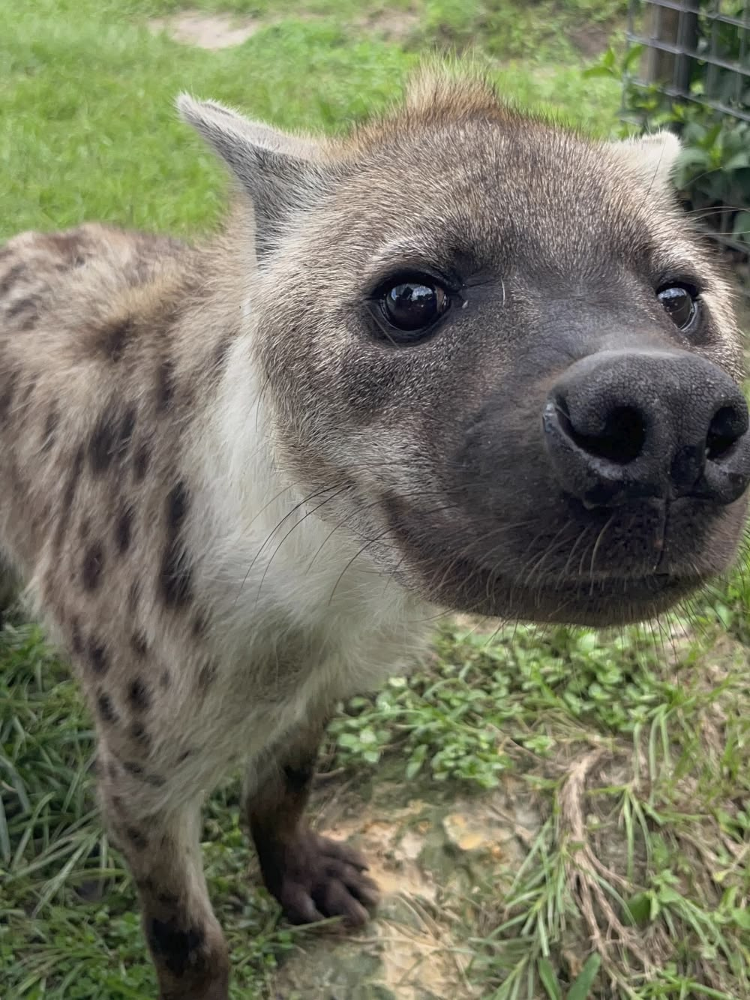

# ATUALIZAÇÕES DE CADA VERSÃO

## v1.2

> criação das pastas scr e scr\models
>
> criação da base da GUI em main
>
> divisão das classes do script classes.py scripts separados

**OBS: A COMUNICAÇÃO ENTRE O MAIN E AS CLASSES NÃO ESTÁ COMPLETA! A REDEFINIÇÃO DAS VARIÁVEIS PRIVADAS PELAS SUBCLASSES PRECISA SER FEITA ATRAVÉS DE GATTERS, E NÃO POR REDEFINIÇÃO DIRETA.**

## Para Kreis e Ray, sempre que fizerem alguma atualização, escrevam aqui!

## v1.3

> Resignificação das classes
>
> Reformulação da janela

**Esta versão é somente uma base para a bifurcação de tarefas entre Kreis e Ranieri**

## v1.4

> inserção do link canva https://canva.link/d8cdfumq2axv68z

 
 
 
 

## v1.5

> Reformulação da janela(Sim, denovo)

